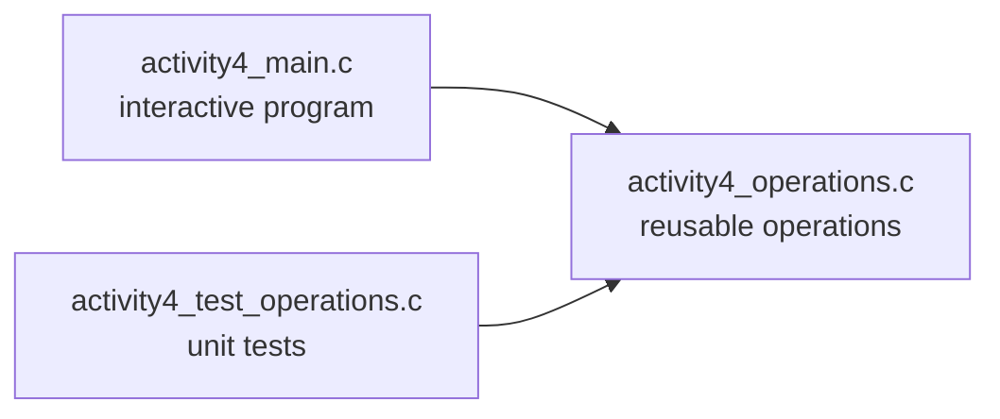

# Testing

<details markdown="block">
  <summary>
    Table of contents
  </summary>
  {: .text-delta }
1. TOC
{:toc}
</details>

## Introduction

Testing code is an extremely important part of the software development cycle. A top-of-the-range car, jam-packed with electronics and sensors, may have upwards of **100 million lines of code**. The fact that a *bug* in the code may cause a [fatal accident](https://en.wikipedia.org/wiki/2009%E2%80%932011_Toyota_vehicle_recalls) means that every single block of code will be tested. Indeed, software engineers often write tests **before** they write the actual code. This is known as **Test-Driven Development (TDD)**.

# Testing

Testing is the process of checking that a program behaves as expected.

A useful test should:

- provide a known input
- check the output
- clearly report whether the test passed or failed

Testing helps us catch bugs quickly and gives us confidence that future changes have not broken existing code.

## A simple example

Suppose we have:

```c
int add(int a, int b)
{
    return a + b;
}
```

A simple test might be:

```c
if (add(2, 3) == 5) {
    printf("PASS\n");
} else {
    printf("FAIL\n");
}
```

The test uses a known input and checks that the result matches our expectation.

## Unit testing

As programs become larger, it is useful to test functions directly rather than repeatedly entering input by hand.

For example, Activity 4 separates the reusable operations from both the application and the tests:



The interactive application is built from:

```text
activity4_main.c + activity4_operations.c
    -> interactive application
```

The test program is built from:

```text
activity4_test_operations.c + activity4_operations.c
    -> automated test executable
```

Both programs use exactly the same operations library.

This allows us to test the functions directly without typing input each time.

## Testing functions directly

For example:

```c
check_int(
    "addition with positive values",
    12,
    operation_add(7, 5)
);
```

The test supplies:

- a known input
- an expected result
- the actual value returned by the function

The test program can then report:

```text
PASS
```

or:

```text
FAIL
```

automatically.

## Choosing test cases

Good tests should include:

- normal inputs
- boundary values
- unusual inputs
- invalid inputs where appropriate

For example:

```c
operation_add(7, 5)
```

```c
operation_multiply(0, 100)
```

```c
operation_divide(9, 2, &result)
```

```c
operation_divide(10, 0, &result)
```

The division-by-zero case is particularly important because it checks behaviour that is easy to overlook.

## Testing and debugging

Testing and debugging work together:

```text
Testing finds a problem
Debugging finds the cause
```

A failed test tells us that something is wrong.

Tools such as `printf()` and breakpoints help us discover why it is wrong.

## A useful approach

When developing a program:

1. Write a small amount of code.
2. Test it.
3. Fix any bugs.
4. Add the next feature.
5. Test again.

Finding a bug in 20 lines of code is usually much easier than finding a bug in 2000 lines of code.

The goal of testing is not to prove that a program is perfect. The goal is to increase our confidence that it behaves correctly.