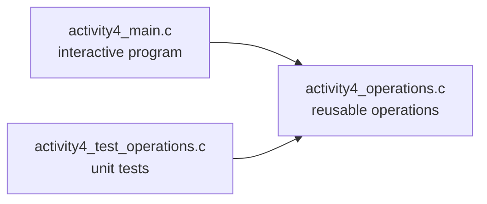

# Testing

<details markdown="block">
  <summary>
    Table of contents
  </summary>
  {: .text-delta }
1. TOC
{:toc}
</details>

Testing code is an extremely important part of the software development cycle. A modern car, jam-packed with electronics and sensors, may have upwards of **100 million lines of code**. The fact that a *bug* in the code may cause a [fatal accident](https://en.wikipedia.org/wiki/2009%E2%80%932011_Toyota_vehicle_recalls) means that every single block of code will be tested. Indeed, software engineers often write tests **before** they write the actual code. This is known as **Test-Driven Development (TDD)**.

## What is a unit test?

A unit test checks one small function on its own:

1. **Pick** one small function, such as `square_int()`.
2. **Call** it with a value you chose, such as `5`.
3. **Compare** the result you expected, `25`, with the result you actually got.

It is like typing 5 x 5 into a calculator to check that it says 25, but automatic and repeatable. The test program prints PASS or FAIL, and you can rerun every test in seconds after each change.

A useful test should:

- provide a known input
- check the output against an expected result
- clearly report whether the test passed or failed

Suppose we have:

```c
int add(int a, int b)
{
    return a + b;
}
```

A simple test might be:

```c
if (add(2, 3) == 5) {
    printf("PASS\n");
} else {
    printf("FAIL\n");
}
```

Testing helps us catch bugs quickly and gives us confidence that future changes have not broken existing code.

## Compile the library twice

To test functions directly, they must live in a file of their own, separate from the menu and the keyboard input (see [splitting a menu program](#splitting-a-menu-program)). The same library file is then compiled into two different programs. In Unit 2.1 Activity 4:



The Unit 2 project template does the same with its own files:

```text
main.c + funcs.c + input.c  ->  application.out   (the interactive program)
test_funcs.c + funcs.c      ->  test_funcs.out    (the automated tests)
```

The test build leaves out `main.c` and `input.c`, so it never shows a menu or waits for the keyboard. Both programs use exactly the same `funcs.c`, so if the tests pass, the functions the application uses work. The template's [Makefile](#the-unit-2-project-makefile) builds and runs the tests with `make test`.

## A small test helper

Writing an `if` and two `printf()` calls for every test gets repetitive. The template's `test_funcs.c` uses a helper function instead:

```c
static int tests_run = 0;
static int tests_failed = 0;

static void check_int(const char *test_name, int expected, int actual)
{
    tests_run++;

    printf("Test: %s\n", test_name);
    printf("  Expected: %d\n", expected);
    printf("  Actual:   %d\n", actual);

    if (expected == actual) {
        printf("  Result:   PASS\n\n");
    } else {
        printf("  Result:   FAIL\n\n");
        tests_failed++;
    }
}
```

The helper does four things:

- counts the test
- shows the expected value
- shows the actual value
- records whether the test passed or failed

The counters are `static` variables outside a function, so every function in `test_funcs.c` can use them but no other file can (see [private variables in a source file](#private-variables-in-a-source-file)). At the end, `main()` prints the totals.

`check_int()` compares whole numbers exactly. Results of type `float` or `double` need a different check, because tiny rounding errors make exact comparisons fail: see [floating-point tests]().

## Anatomy of one test

```c
check_int("square positive integer", 25, square_int(5));
```

| Part | In this test |
|---|---|
| Test name | `"square positive integer"` |
| Input | `5` |
| Expected result | `25` |
| Actual result | `square_int(5)` |
| Pass rule | expected equals actual |

This prints:

```text
Test: square positive integer
  Expected: 25
  Actual:   25
  Result:   PASS
```

Known input, known expected result, compare with the actual result. Give every test a name that says what it checks, so a failure tells you where to look.

## Say what you mean

A programmer's partner says: "Go to the shop and buy a loaf of bread. If they have eggs, buy a dozen." The programmer comes back with 12 loaves of bread. "Why did you buy 12 loaves?!" "They had eggs."

The code did exactly what you asked. Tests check that what you asked for is what you meant.

## Choosing test cases

Good tests cover more than the comfortable examples you thought of first:

| Category | Example |
|---|---|
| Normal | `square_int(5)` is `25` |
| Negative | `cube_int(-2)` is `-8` |
| Zero | `square_int(0)` is `0` |
| Boundary | `square_int(46340)` is `2147395600` |
| Invalid or error | `percentage(3, 0, &result)` reports failure |

The boundary case is the largest value whose square fits in a 32-bit `int`. The square of `46341` is `2147488281`, which is bigger than the largest `int`, `2147483647`. In C, overflowing an `int` is undefined behaviour, so there is no right answer to test against. The boundary test records where the function stops working. If your program could ever pass a bigger value, check the range before calling the function.

Several comfortable examples are not a convincing test set. Tests should cover every eventuality, as in this well-known joke by Brenan Keller (2018):

> A QA engineer walks into a bar. Orders a beer. Orders 0 beers. Orders 99999999999 beers. Orders a lizard. Orders -1 beers. Orders a ueicbksjdhd.
>
> First real customer walks in and asks where the bathroom is. The bar bursts into flames, killing everyone.

Real users do things you did not think of. Include the strange inputs too.

## Testing a function with success and result outputs

Some functions can fail. A common pattern returns `1` for success or `0` for failure, and writes the answer through a pointer (see [pointers and functions]()):

```c
int percentage(int part, int total, int *result)
{
    if (total == 0) {
        return 0;
    }

    *result = part * 100 / total;
    return 1;
}
```

On success, test both outputs. On failure, test only the return value:

```c
int result;
int success;

// Success: check the return value and the result
success = percentage(3, 4, &result);
check_int("percentage succeeds", 1, success);
check_int("3 out of 4 is 75 percent", 75, result);

// Failure: check the return value only
success = percentage(3, 0, &result);
check_int("percentage of a zero total fails", 0, success);
```

Do not check `result` after a failure: nothing was written to it. Here it still holds `75` from the previous call, so a test of it would be checking leftovers. Without the earlier call, it would be uninitialised.

## Beware the test that proves nothing

Delete every `check_int()` call from the template's `test_funcs.c` and run `make test`:

```text
./test_funcs.out
Tests run: 0
Tests failed: 0
All tests passed.
```

Every test passed, because there were none. (GCC does give a hint: `warning: ‘check_int’ defined but not used`.)

> "Program testing can be used to show the presence of bugs, but never to show their absence!"
>
> Edsger W. Dijkstra, 1970

Passing tests only mean something if the tests are good. Cover normal, boundary and error cases.

## Make a test fail on purpose

To check that your tests can fail, change one expected value to something wrong, for example `26` instead of `25`, and run `make test` again:

```text
Test: square positive integer
  Expected: 26
  Actual:   25
  Result:   FAIL

...

Tests run: 5
Tests failed: 1
Some tests failed.
make: *** [Makefile:48: test] Error 1
```

The failing test is named, the expected and actual values are shown, and the test program returns `1` from `main()`, so `make` reports an error as well. Put the correct value back before you commit.

## Complete example

Three files: the library header, the library, and the test program.

```c
// funcs.h

#ifndef FUNCS_H
#define FUNCS_H

int square_int(int value);
int cube_int(int value);

// Returns 1 and writes part as a percentage of total to *result.
// Returns 0 and writes nothing if total is 0.
int percentage(int part, int total, int *result);

#endif
```

```c
// funcs.c

#include "funcs.h"

int square_int(int value)
{
    return value * value;
}

int cube_int(int value)
{
    return value * value * value;
}

int percentage(int part, int total, int *result)
{
    if (total == 0) {
        return 0;
    }

    *result = part * 100 / total;
    return 1;
}
```

```c
// test_funcs.c

#include <stdio.h>
#include "funcs.h"

static int tests_run = 0;
static int tests_failed = 0;

static void check_int(const char *test_name, int expected, int actual)
{
    tests_run++;

    printf("Test: %s\n", test_name);
    printf("  Expected: %d\n", expected);
    printf("  Actual:   %d\n", actual);

    if (expected == actual) {
        printf("  Result:   PASS\n\n");
    } else {
        printf("  Result:   FAIL\n\n");
        tests_failed++;
    }
}

int main(void)
{
    int result;
    int success;

    check_int("square positive integer", 25, square_int(5));
    check_int("cube negative integer", -8, cube_int(-2));
    check_int("square zero", 0, square_int(0));
    check_int("square largest safe value", 2147395600, square_int(46340));

    success = percentage(3, 4, &result);
    check_int("percentage succeeds", 1, success);
    check_int("3 out of 4 is 75 percent", 75, result);

    success = percentage(3, 0, &result);
    check_int("percentage of a zero total fails", 0, success);

    printf("Tests run: %d\n", tests_run);
    printf("Tests failed: %d\n", tests_failed);

    if (tests_failed == 0) {
        printf("All tests passed.\n");
        return 0;
    }

    printf("Some tests failed.\n");
    return 1;
}
```

Compile the tests with the library, but without any `main.c`:

```bash
gcc -Wall -Wextra -Wpedantic -std=c11 test_funcs.c funcs.c -o test_funcs.out
./test_funcs.out
```

This prints:

```text
Test: square positive integer
  Expected: 25
  Actual:   25
  Result:   PASS

Test: cube negative integer
  Expected: -8
  Actual:   -8
  Result:   PASS

Test: square zero
  Expected: 0
  Actual:   0
  Result:   PASS

Test: square largest safe value
  Expected: 2147395600
  Actual:   2147395600
  Result:   PASS

Test: percentage succeeds
  Expected: 1
  Actual:   1
  Result:   PASS

Test: 3 out of 4 is 75 percent
  Expected: 75
  Actual:   75
  Result:   PASS

Test: percentage of a zero total fails
  Expected: 0
  Actual:   0
  Result:   PASS

Tests run: 7
Tests failed: 0
All tests passed.
```

## Testing and debugging

Testing and debugging work together:

```text
Testing finds a problem
Debugging finds the cause
```

A failed test tells us that something is wrong.

Tools such as [`printf()`]() and [breakpoints]() help us discover why it is wrong.

## A useful approach

When developing a program:

1. Write a small amount of code.
2. Test it.
3. Fix any bugs.
4. Add the next feature.
5. Test again.

Finding a bug in 20 lines of code is usually much easier than finding a bug in 2000 lines of code.

The goal of testing is not to prove that a program is perfect. The goal is to increase our confidence that it behaves correctly.

The main points to remember are:

- a unit test calls one function with a known input and compares the expected result with the actual result
- the same library is compiled twice: once with `main.c` for the application, once with `test_funcs.c` for the tests
- cover normal, negative, zero, boundary and invalid cases, not only comfortable examples
- when a function reports success and writes a result through a pointer, only check the result after a success
- zero tests means zero evidence: make sure your tests can fail
