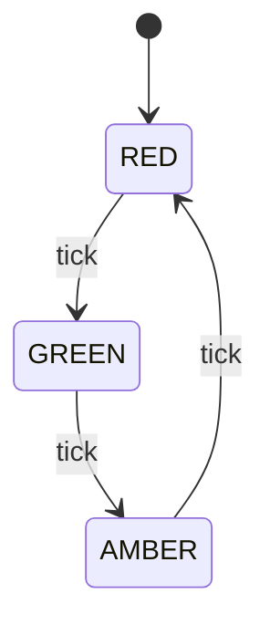

# Finite state machines

For when your program needs to know which mode it is in, not just which function it happens to be stuck inside.

A finite state machine (FSM) is always in exactly one of a small number of states, and events move it from one state to the next. A traffic light is one: a timer tick moves it on, and after AMBER it goes back to RED.

```c
#include <stdio.h>

typedef enum {
    LIGHT_RED,
    LIGHT_GREEN,
    LIGHT_AMBER
} LightState;

int main(void)
{
    LightState light = LIGHT_RED;  // the light starts at red

    // Each pass round the loop is one timer tick (the event)
    for (int tick = 1; tick <= 4; tick++) {
        switch (light) {
            case LIGHT_RED:
                printf("Tick %d: RED    cars wait\n", tick);
                light = LIGHT_GREEN;
                break;

            case LIGHT_GREEN:
                printf("Tick %d: GREEN  cars go\n", tick);
                light = LIGHT_AMBER;
                break;

            case LIGHT_AMBER:
                printf("Tick %d: AMBER  get ready to stop\n", tick);
                light = LIGHT_RED;
                break;
        }
    }

    return 0;
}
```

This prints:

```text
Tick 1: RED    cars wait
Tick 2: GREEN  cars go
Tick 3: AMBER  get ready to stop
Tick 4: RED    cars wait
```

The variable `light` always says which state the light is in. The same design as a state diagram:



[Going back to the menu]() showed a menu where the current mode was stored nowhere. The pages in this section rebuild that menu as an FSM, as Unit 2.1 Activity 2 does, using the Square, Cube and Exit example from the Unit 2 project template.
