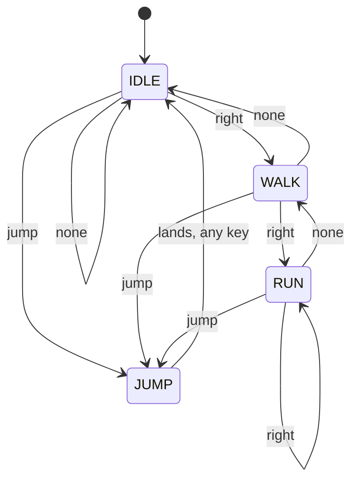
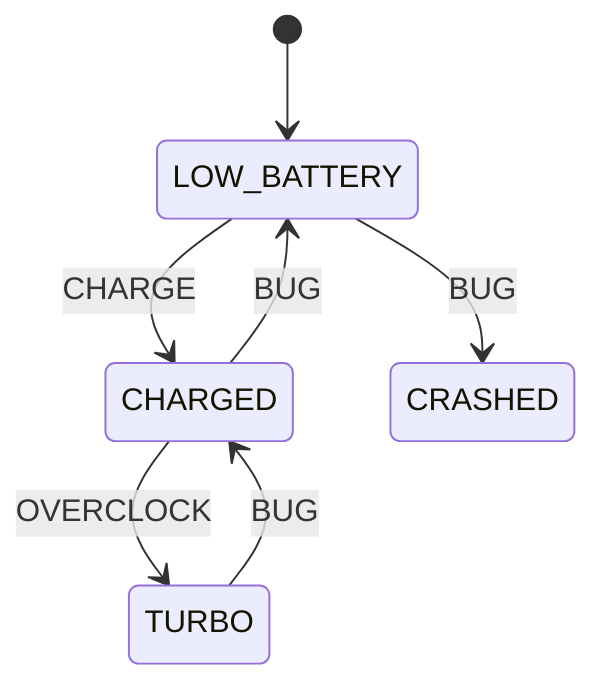

# Game characters as state machines

<details markdown="block">
  <summary>
    Table of contents
  </summary>
  {: .text-delta }
1. TOC
{:toc}
</details>

Video games run on state machines. A game character is always in exactly one pose, such as standing, walking or jumping, and the buttons you press move it between them. This page builds a small one for the ELEC2645 Bot, `d[o_0]b`.

## States, events and actions in a game

The four words from [states, events and transitions]() mean the same thing in a game:

| Word | In a game | For the bot |
|---|---|---|
| State | a pose | `IDLE`, `WALK`, `RUN`, `JUMP` |
| Event | a key press, or no key | right, jump, none |
| Transition | a change of pose | press right while idle: `IDLE` to `WALK` |
| Action | play the pose's animation | the idle bot blinks, the walking bot moves |

The bot starts in `IDLE`, just as the menu starts in `MAIN_MENU`.

## The bot's state diagram



The same key does different things in different states. Pressing right while idle starts a walk, pressing it while walking starts a run, and pressing it in the air does nothing. That is why the bot needs a state machine: the key on its own does not say what happens next.

## The game loop

A game runs the same loop many times a second. Each time round (one *tick*), it does three things:

1. **Read** the input: which key is pressed?
2. **Update** the state: current state plus event gives the next state.
3. **Show** the result: draw the character in its new state.

This is the menu FSM loop from [writing an FSM in C]() again. The difference is that a game does not wait for you to press Enter: if no key is pressed, that is an event too. You will use this pattern again in Units 3 and 4.

## The transition function

All the arrows on the diagram fit in one function:

```c
BotState update_state(BotState state, KeyEvent key)
{
    switch (state) {
        case BOT_IDLE:
            if (key == KEY_RIGHT) {
                return BOT_WALK;
            } else if (key == KEY_JUMP) {
                return BOT_JUMP;
            }
            return BOT_IDLE;

        case BOT_WALK:
            if (key == KEY_RIGHT) {
                return BOT_RUN;
            } else if (key == KEY_JUMP) {
                return BOT_JUMP;
            }
            return BOT_IDLE;

        case BOT_RUN:
            if (key == KEY_RIGHT) {
                return BOT_RUN;
            } else if (key == KEY_JUMP) {
                return BOT_JUMP;
            }
            return BOT_WALK;

        case BOT_JUMP:
            return BOT_IDLE;  // keys do nothing in the air; the bot lands
    }

    return state;
}
```

Each `case` is one state, and each `return` is one arrow leaving it. The function does not read the keyboard or print anything. It only answers "current state plus event gives which next state?", so it is easy to [test](): `update_state(BOT_WALK, KEY_RIGHT)` should return `BOT_RUN`.

## Complete example

The key presses come from an array instead of the keyboard, so the program gives the same output every time.

```c
#include <stdio.h>

typedef enum {
    BOT_IDLE,
    BOT_WALK,
    BOT_RUN,
    BOT_JUMP
} BotState;

typedef enum {
    KEY_NONE,
    KEY_RIGHT,
    KEY_JUMP
} KeyEvent;

BotState update_state(BotState state, KeyEvent key);
void draw_bot(BotState state, int x, int tick);
const char *state_name(BotState state);

int main(void)
{
    // The key pressed on each tick, in place of reading a real keyboard
    const KeyEvent keys[] = {
        KEY_NONE, KEY_NONE, KEY_RIGHT, KEY_RIGHT, KEY_RIGHT,
        KEY_JUMP, KEY_RIGHT, KEY_NONE, KEY_NONE
    };
    const int num_ticks = sizeof(keys) / sizeof(keys[0]);
    const char *key_names[] = { "none", "right", "jump" };  // same order as KeyEvent

    BotState state = BOT_IDLE;  // the character starts idle
    int x = 0;                  // how far across the screen the bot is

    for (int tick = 0; tick < num_ticks; tick++) {
        state = update_state(state, keys[tick]);  // read input, update state

        // The walk and run actions move the bot
        if (state == BOT_WALK) {
            x += 1;
        } else if (state == BOT_RUN) {
            x += 3;
        }

        printf("%-5s -> ", key_names[keys[tick]]);
        draw_bot(state, x, tick);  // show the result
    }

    return 0;
}

BotState update_state(BotState state, KeyEvent key)
{
    switch (state) {
        case BOT_IDLE:
            if (key == KEY_RIGHT) {
                return BOT_WALK;
            } else if (key == KEY_JUMP) {
                return BOT_JUMP;
            }
            return BOT_IDLE;

        case BOT_WALK:
            if (key == KEY_RIGHT) {
                return BOT_RUN;
            } else if (key == KEY_JUMP) {
                return BOT_JUMP;
            }
            return BOT_IDLE;

        case BOT_RUN:
            if (key == KEY_RIGHT) {
                return BOT_RUN;
            } else if (key == KEY_JUMP) {
                return BOT_JUMP;
            }
            return BOT_WALK;

        case BOT_JUMP:
            return BOT_IDLE;  // keys do nothing in the air; the bot lands
    }

    return state;
}

void draw_bot(BotState state, int x, int tick)
{
    const char *face = "d[o_0]b";

    if (state == BOT_IDLE && tick % 2 == 1) {
        face = "d[-_-]b";  // the idle animation blinks
    } else if (state == BOT_JUMP) {
        face = "d[^_^]b";
    }

    printf("%-5s |", state_name(state));
    for (int i = 0; i < x; i++) {
        printf(" ");
    }
    printf("%s\n", face);
}

const char *state_name(BotState state)
{
    switch (state) {
        case BOT_IDLE:
            return "IDLE";
        case BOT_WALK:
            return "WALK";
        case BOT_RUN:
            return "RUN";
        case BOT_JUMP:
            return "JUMP";
    }
    return "?";
}
```

This prints:

```text
none  -> IDLE  |d[o_0]b
none  -> IDLE  |d[-_-]b
right -> WALK  | d[o_0]b
right -> RUN   |    d[o_0]b
right -> RUN   |       d[o_0]b
jump  -> JUMP  |       d[^_^]b
right -> IDLE  |       d[o_0]b
none  -> IDLE  |       d[-_-]b
none  -> IDLE  |       d[o_0]b
```

Each line is one tick: the key, the new state, then the bot drawn at its position. On the line after `jump`, right is pressed but ignored, because the bot is in the air. To redraw the bot in one place instead of printing a new line each tick, see [redrawing the screen](#redrawing-the-screen) in fancy terminal output.

## Checking a design: power-ups

Many games also have a second state machine for the character's power. Here the bot runs on batteries:



Every time the bot hits a `BUG`, it drops down one state. Each state has an action on entering it: the bot changes to that state's look.

| State | Look |
|---|---|
| `LOW_BATTERY` | `d[._.]b` |
| `CHARGED` | `d[o_0]b` |
| `TURBO` | `d[O_O]b` |
| `CRASHED` | `d[x_x]b` |

Drawing the diagram makes questions visible before anyone writes code:

- `CRASHED` has no arrows leaving it. Is that a [Hotel California](#the-hotel-california-state) bug, or is it game over? If it is game over, the diagram should say so, for example with an arrow to the end.
- Can a `CHARGE` bring the bot back from `CRASHED`? At the moment it cannot. Is that what the designer meant?
- What does `CHARGE` do in `TURBO`? There is no arrow, so it is ignored. Is that what the designer meant?

None of these are coding questions. A diagram lets you answer them while changing the design is still cheap.

## Common mistakes

### Choosing the pose from the key alone

If right always means `WALK`, the bot can never run, and it can change pose in mid-air. When the next state depends on the current state as well as the key, you need the `switch` on the current state.

### Reading input or printing inside the transition function

Keep `update_state()` to working out the next state. If it also reads the keyboard or draws the bot, you cannot test it with known inputs, and the read, update and show steps get tangled together.

### Adding a pose but not handling it

The switches in this program have no `default` case, so GCC warns about any state they do not handle. Adding `BOT_CROUCH` to the `enum` without updating them gives:

```text
bot_game.c:53:5: warning: enumeration value ‘BOT_CROUCH’ not handled in switch [-Wswitch]
bot_game.c:104:5: warning: enumeration value ‘BOT_CROUCH’ not handled in switch [-Wswitch]
```

One warning for `update_state()` and one for `state_name()`. Treat them as a to-do list.

The main points to remember are:

- a game character is a state machine: poses are states, key presses are events, and each pose plays its own animation
- the game loop reads the input, updates the state and shows the result, every tick
- the same event can lead to different states, depending on the current state
- a transition function that only returns the next state is easy to test
- drawing the diagram shows design questions, such as a state with no way out, before you write code
