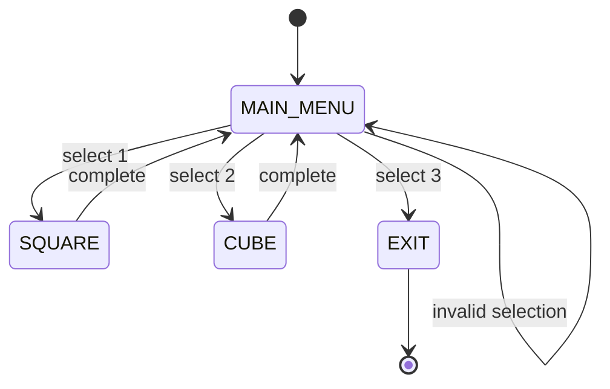

# States, events and transitions

<details markdown="block">
  <summary>
    Table of contents
  </summary>
  {: .text-delta }
1. TOC
{:toc}
</details>

An FSM is designed before it is coded: you decide which states the program has and which events move it between them. This page designs the FSM for the Square, Cube and Exit menu in the Unit 2 project template. [Writing an FSM in C]() turns the design into code.

## Four words

Four words describe the whole design:

| Word | Meaning | In the Square and Cube menu |
|---|---|---|
| State | which mode the program is in right now | `STATE_CUBE` |
| Event | something that happens | the user types `2` |
| Transition | moving from one state to another | main menu to cube |
| Action | the job done while in a state | calculate the cube |

An FSM writes down which mode you are in, and which moves are allowed.

## The state diagram

In a state diagram, states are the boxes and events label the arrows between them:



The filled dot at the top is where the program starts, and the ringed dot at the bottom is where it ends. Reading the diagram:

- the program starts in `MAIN_MENU`
- from `MAIN_MENU`, selecting 1, 2 or 3 moves to `SQUARE`, `CUBE` or `EXIT`
- an invalid selection loops back to `MAIN_MENU`, so a typing mistake does not crash or exit the program
- `SQUARE` and `CUBE` each have one way out: when the calculation is complete, back to `MAIN_MENU`
- `EXIT` is the only way the program ends

## The transition table

The same design can be written as a table. Each arrow between two states becomes one row:

| Current state | Event | Next state |
|---|---|---|
| Main menu | select square | Square |
| Square | calculation completed | Main menu |
| Main menu | select cube | Cube |
| Cube | calculation completed | Main menu |
| Main menu | invalid selection | Main menu |
| Main menu | select exit | Exit |

Current state plus event gives the next state. That is the whole rule.

A table is useful when the diagram gets crowded and the arrow labels start to overlap. It also makes gaps easy to spot: if a state never appears in the "Current state" column, nothing can move the program out of it.

## What a good FSM diagram shows

The Unit 2 Software Design journal entry asks for an FSM diagram at about this level of detail. A good one shows:

- meaningful states: the modes of the application, not every helper function
- an arrow for every transition
- an event label on every arrow
- where the program starts and where it exits
- important error or invalid-input routes, such as the invalid selection above

The diagram and the code must agree. If you add a state to the code, add it to the diagram as well.

## Is every menu an FSM?

Not on its own. A menu with one `switch` that calls unrelated functions has states in name only. In the Square and Cube menu the states are deliberately simple, so the pattern is easy to see.

In your project, the states should be the real modes of one application, and some of them should lead somewhere other than the menu. A quiz, for example, might go from `MAIN_MENU` to `ASK_QUESTION`, then to `SHOW_ANSWER`, back to `ASK_QUESTION` until the questions run out, and then to `SHOW_SCORE`.

## Complete example

Mermaid diagrams are written as text inside a `mermaid` code block, so they can live in your project's `README.md` next to your code. GitHub draws them when you view the README, and so does the Markdown preview in your Codespace. This is the source of the diagram above:

````markdown

````

Each line is one arrow: `FROM --> TO: event`. `[*]` is the start when it is on the left of an arrow and the end when it is on the right. State names cannot contain spaces, so use underscores.

The transition table is an ordinary Markdown table:

```markdown
| Current state | Event | Next state |
|---|---|---|
| Main menu | select square | Square |
| Square | calculation completed | Main menu |
```

## Common mistakes

- **A state with no way out.** Every state except the exit needs at least one arrow leaving it. Otherwise the program gets stuck there.
- **Helper functions drawn as states.** `print_main_menu()` is part of the main menu state's action, not a state of its own.
- **Missing invalid-input routes.** If the user can type something unexpected, the diagram should say where the program goes next.
- **Unlabelled arrows.** An arrow without an event does not say what makes the transition happen.

The main points to remember are:

- a state is a mode, an event is something that happens, a transition is a move between states and an action is the work done in a state
- design the states and transitions before writing the code
- a state diagram and a transition table show the same design in two ways
- every state needs a way out, and invalid input needs a route too
- keep the diagram and the code in step
