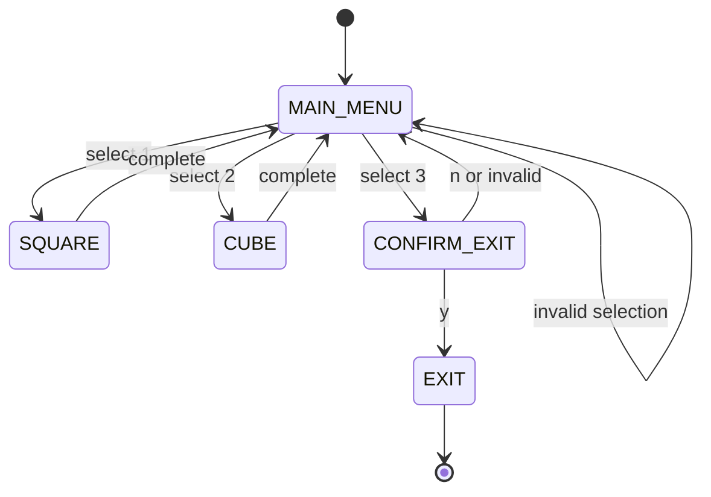

# Adding a state

<details markdown="block">
  <summary>
    Table of contents
  </summary>
  {: .text-delta }
1. TOC
{:toc}
</details>

New features in an FSM program usually mean new states. This page works through the eight steps for adding one, using the program from [writing an FSM in C](). The new state asks "Are you sure?" before the program exits. Features in your own project are added the same way.

## The new design

At the moment, selecting 3 exits straight away. With the new `CONFIRM_EXIT` state, selecting 3 asks first: `y` exits, and anything else goes back to the menu.



`CONFIRM_EXIT` is the first state with two ways out. The square and cube states always go back to the menu, but this one has to choose.

## The eight steps

| Step | What to do |
|---|---|
| 1 | Add the `enum` value |
| 2 | Print the menu option |
| 3 | Map the selection to the state |
| 4 | Add the state's `case` to the loop |
| 5 | Write the state's action |
| 6 | Add the transitions out of the state |
| 7 | Update the FSM diagram |
| 8 | Test the routes and the errors |

The states in the code and the states on the diagram should always agree.

### 1. Add the enum value

```c
typedef enum {
    STATE_MAIN_MENU,
    STATE_SQUARE,
    STATE_CUBE,
    STATE_CONFIRM_EXIT,
    STATE_EXIT
} AppState;
```

### 2. Print the menu option

No change is needed this time: "3. Exit" stays as it is, but it now leads somewhere new. If a new state is reached through a new menu option, add a line to `print_main_menu()` and keep its number the same as the one in the `switch` in step 3.

### 3. Map the selection to the state

In `run_main_menu()`, selecting 3 now returns the new state instead of `STATE_EXIT`:

```c
case 3:
    return STATE_CONFIRM_EXIT;
```

### 4. Add the state's case

In the loop in `main()`:

```c
case STATE_CONFIRM_EXIT:
    state = run_confirm_exit_state();
    break;
```

### 5. Write the state's action

The action asks the question and reads a one-letter answer:

```c
AppState run_confirm_exit_state(void)
{
    char answer;

    if (!read_char("Are you sure you want to exit? (y/n): ", &answer)) {
        printf("Please type y or n. Back to the menu.\n");
        return STATE_MAIN_MENU;
    }

    if (answer == 'y' || answer == 'Y') {
        return STATE_EXIT;
    }

    printf("Back to the menu.\n");
    return STATE_MAIN_MENU;
}
```

`read_char()` is `read_integer()` from [user input]() with `%c` in place of `%d`:

```c
int read_char(const char *prompt, char *value)
{
    char line[64];
    char extra;

    printf("%s", prompt);

    if (fgets(line, sizeof(line), stdin) == NULL) {
        return 0;
    }

    if (sscanf(line, " %c %c", value, &extra) != 1) {
        return 0;
    }

    return 1;
}
```

The space before the first `%c` skips any spaces before the letter. The second `%c` catches extra text, so `yes` or `no way` is rejected as invalid, just as `5 apples` is rejected by `read_integer()`.

### 6. Add the transitions

The two `return` statements in `run_confirm_exit_state()` are the two arrows out of `CONFIRM_EXIT`. The square state always goes back to the menu, so `main()` sets that next state itself. This state has a choice to make, so it returns the next state, in the same way as `run_main_menu()`.

### 7. Update the FSM diagram

The diagram at the top of this page is the updated one. In the transition table, one row changes and two are added:

| Current state | Event | Next state |
|---|---|---|
| Main menu | select exit | Confirm exit |
| Confirm exit | `y` | Exit |
| Confirm exit | `n` or invalid | Main menu |

### 8. Test the routes and the errors

Test every arrow out of the new state, and the invalid input:

| Test | Input | Expected result |
|---|---|---|
| Exit | `3`, then `y` | "Exiting application." and the program ends |
| Exit, capital letter | `3`, then `Y` | the program ends |
| Change your mind | `3`, then `n` | "Back to the menu." and the menu is shown |
| Wrong letter | `3`, then `x` | "Back to the menu." and the menu is shown |
| Empty answer | `3`, then Enter | "Please type y or n. Back to the menu." |
| Too much text | `3`, then `yes` | "Please type y or n. Back to the menu." |
| Spaces round the answer | `3`, then `  y  ` | the program ends |

The routes through `SQUARE` and `CUBE` have not changed, but check them again: a new state can break an old one, for example through a missing `break`.

In your project, a new feature usually needs two more steps: move its reusable logic into a library function, as in [splitting a menu program](#splitting-a-menu-program), and add [tests]() for that function. The confirm-exit state has no calculation, so it has nothing to move.

## Complete example

```c
#include <stdio.h>

typedef enum {
    STATE_MAIN_MENU,
    STATE_SQUARE,
    STATE_CUBE,
    STATE_CONFIRM_EXIT,
    STATE_EXIT
} AppState;

AppState run_main_menu(void);
void print_main_menu(void);
void run_square_state(void);
void run_cube_state(void);
AppState run_confirm_exit_state(void);
int read_integer(const char *prompt, int *value);
int read_char(const char *prompt, char *value);

int main(void)
{
    AppState state = STATE_MAIN_MENU;

    while (state != STATE_EXIT) {
        switch (state) {
            case STATE_MAIN_MENU:
                state = run_main_menu();
                break;

            case STATE_SQUARE:
                run_square_state();
                state = STATE_MAIN_MENU;
                break;

            case STATE_CUBE:
                run_cube_state();
                state = STATE_MAIN_MENU;
                break;

            case STATE_CONFIRM_EXIT:
                state = run_confirm_exit_state();
                break;

            case STATE_EXIT:
                break;

            default:
                printf("Unknown state. Returning to the main menu.\n");
                state = STATE_MAIN_MENU;
                break;
        }
    }

    printf("Exiting application.\n");
    return 0;
}

AppState run_main_menu(void)
{
    int selection;

    print_main_menu();

    if (!read_integer("Select item: ", &selection)) {
        printf("Invalid input. Please enter a menu number.\n");
        return STATE_MAIN_MENU;
    }

    switch (selection) {
        case 1:
            return STATE_SQUARE;

        case 2:
            return STATE_CUBE;

        case 3:
            return STATE_CONFIRM_EXIT;

        default:
            printf("Invalid menu selection.\n");
            return STATE_MAIN_MENU;
    }
}

void print_main_menu(void)
{
    printf("\n1. Square an integer\n");
    printf("2. Cube an integer\n");
    printf("3. Exit\n");
}

void run_square_state(void)
{
    int value;

    printf("\n>> Square an integer\n");

    if (!read_integer("Enter an integer: ", &value)) {
        printf("Invalid integer. Returning to the menu.\n");
        return;
    }

    printf("Result: %d\n", value * value);
}

void run_cube_state(void)
{
    int value;

    printf("\n>> Cube an integer\n");

    if (!read_integer("Enter an integer: ", &value)) {
        printf("Invalid integer. Returning to the menu.\n");
        return;
    }

    printf("Result: %d\n", value * value * value);
}

AppState run_confirm_exit_state(void)
{
    char answer;

    if (!read_char("Are you sure you want to exit? (y/n): ", &answer)) {
        printf("Please type y or n. Back to the menu.\n");
        return STATE_MAIN_MENU;
    }

    if (answer == 'y' || answer == 'Y') {
        return STATE_EXIT;
    }

    printf("Back to the menu.\n");
    return STATE_MAIN_MENU;
}

int read_integer(const char *prompt, int *value)
{
    char line[64];
    char extra;

    printf("%s", prompt);

    if (fgets(line, sizeof(line), stdin) == NULL) {
        return 0;
    }

    if (sscanf(line, "%d %c", value, &extra) != 1) {
        return 0;
    }

    return 1;
}

int read_char(const char *prompt, char *value)
{
    char line[64];
    char extra;

    printf("%s", prompt);

    if (fgets(line, sizeof(line), stdin) == NULL) {
        return 0;
    }

    if (sscanf(line, " %c %c", value, &extra) != 1) {
        return 0;
    }

    return 1;
}
```

This produces (typing `3`, `n`, `3`, `y`):

```text
1. Square an integer
2. Cube an integer
3. Exit
Select item: 3
Are you sure you want to exit? (y/n): n
Back to the menu.

1. Square an integer
2. Cube an integer
3. Exit
Select item: 3
Are you sure you want to exit? (y/n): y
Exiting application.
```

## Diagram, code and evidence

An FSM design has three parts, and they must match:

| Part | What it contains |
|---|---|
| Diagram | the states, events and transitions |
| Code | the `enum`, the state variable and the loop |
| Evidence | tests showing the valid routes work and errors are recovered from |

Make the mode explicit, define every transition, and keep the diagram in step with the code. One state variable controls what happens next.

## Common mistakes

### A missing case

If you forget step 4, nothing in the loop handles `STATE_CONFIRM_EXIT`, so the `default` case catches it. Selecting 3 gives:

```text
Select item: 3
Unknown state. Returning to the main menu.
```

The program never exits. The `default` case keeps it running, but it also hides a GCC warning. Without a `default`, `-Wall` reports the missing state when you compile:

```text
fsm_menu.c:24:9: warning: enumeration value ‘STATE_CONFIRM_EXIT’ not handled in switch [-Wswitch]
```

If you ever see "Unknown state", check that every state in the `enum` has a `case`.

### One state does everything

A single state whose action runs its own menu and its own loop puts the nesting back inside one function, and the FSM adds little. Each distinct mode of the program should be its own state.

### The "Hotel California" state

You can always get in, but there is no way out. A `SETTINGS` state whose action only ever returns `STATE_SETTINGS` traps the user for good. For every state, ask: "how do I leave?" On the diagram, every state except `EXIT` needs at least one arrow leaving it.

### The undocumented state

"It's not a bug, it's an undocumented state." If you skip step 7, the code has five states and the diagram in your README still shows four. Anyone reading the diagram gets the wrong idea of how the program works, including you a few weeks later. If a state is in the code, it must be on the diagram. Counting the `enum` values and the boxes on the diagram is a quick check.

The main points to remember are:

- adding a feature to an FSM program usually means adding a state
- follow the eight steps, from the `enum` value to testing the routes and errors
- a state with more than one way out returns its next state
- test every arrow out of a new state, and the invalid input, and recheck the old routes
- every state needs a way out, and every state in the code needs a place on the diagram
