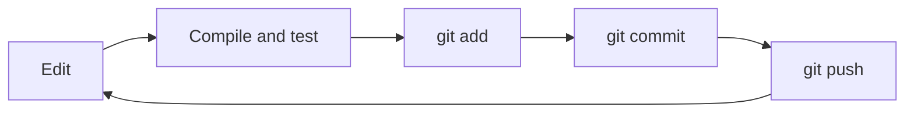

# Git and GitHub

For when your project folder looks like this:

```text
main.c
main_final.c
main_final_fixed.c
main_final_fixed_2.c
main_ACTUALLY_FINAL.c
```

Which one works? What changed? Can we go back?

Git is version-control software: it runs on your computer and records the history of your project as a series of commits. GitHub is an online service that stores a copy of that history, so you can work from different computers and share a project with other people.

| Git | GitHub |
| --- | --- |
| software on your computer (or in your Codespace) | a website that hosts repositories |
| records commits in your local repository | stores a shared copy of the repository |
| works without GitHub | provides Codespaces, pull requests and GitHub Classroom |

The everyday loop is: make the code work, then record the change and send it to GitHub.



After editing and testing `main.c`, recording and sharing the change takes three commands:

```bash
git add main.c
git commit -m "Add Celsius conversion"
git push
```

`git commit` prints:

```text
[main 2fa8bf0] Add Celsius conversion
 1 file changed, 6 insertions(+), 1 deletion(-)
```

`git push` prints a few progress lines, then ends with the commit moving from your copy to GitHub:

```text
   2f3d843..2fa8bf0  main -> main
```

You will use Git from the first weeks of Unit 1. In Unit 2 your project journal links to individual commits, and in Unit 4 your whole group works on one shared repository. The pages in this section go from working on your own to working as a team.
