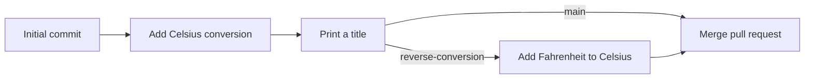

# Branches and pull requests

<details markdown="block">
  <summary>
    Table of contents
  </summary>
  {: .text-delta }
1. TOC
{:toc}
</details>

A branch is a named line of development, not another copied folder. It lets you work on a feature or an experiment without changing `main` until it works. A pull request then proposes bringing that work back into `main`.

This page continues the temperature converter from [The everyday workflow](), adding a Fahrenheit to Celsius conversion on its own branch. The output shown is from a real run.



## Creating a branch

`git switch -c` creates a new branch and moves onto it:

```bash
git switch -c reverse-conversion
```

```text
Switched to a new branch 'reverse-conversion'
```

`git branch` lists the branches, with a `*` next to the one you are on:

```text
  main
* reverse-conversion
```

Name a branch after what it is for: `reverse-conversion`, `menu-input-checks`, `lava-hop-levels`. No spaces.

## Working on the branch

Edit, compile, test and commit exactly as before. Here the new function is:

```c
double fahrenheit_to_celsius(double fahrenheit)
{
    return (fahrenheit - 32.0) * 5.0 / 9.0;
}
```

with one more line in `main()`, so the program prints:

```text
Temperature converter
20.0 C is 68.0 F
68.0 F is 20.0 C
```

Then commit it:

```bash
git add main.c
git commit -m "Add Fahrenheit to Celsius conversion"
```

```text
[reverse-conversion 6d3f55f] Add Fahrenheit to Celsius conversion
 1 file changed, 6 insertions(+)
```

The commit is on `reverse-conversion` only. `main` has not changed.

## Publishing the branch

The first time you push a new branch, tell Git where it goes on GitHub:

```bash
git push -u origin reverse-conversion
```

```text
 * [new branch]      reverse-conversion -> reverse-conversion
branch 'reverse-conversion' set up to track 'origin/reverse-conversion'.
```

`-u` links your branch to the one on GitHub, so after this a plain `git push` works. When pushing to GitHub, the output also includes a link for creating a pull request.

## Opening a pull request

A pull request is a GitHub feature for proposing and reviewing changes before they are merged into another branch. On GitHub:

1. Open the repository. A banner says your branch had recent pushes: click **Compare & pull request**. (Or open the **Pull requests** tab and click **New pull request**.)
2. Check the two branches at the top: **base** is where the changes go (`main`), **compare** is your branch (`reverse-conversion`).
3. Give it a title and a short description: what the change does and how you tested it.
4. Click **Create pull request**.
5. Look at the **Files changed** tab. It shows the same kind of diff as `git diff`, and anyone with access can comment on individual lines.
6. When you are happy, click **Merge pull request**, then **Confirm merge**.
7. Click **Delete branch** to tidy up. The commits are kept in `main`.

A pull request is most useful when someone actually reads the changes before merging! Even reading your own pull request's **Files changed** tab catches forgotten debug prints.

## Updating your copy

The merge happened on GitHub, so your copy does not have it yet. Switch back to `main` and pull:

```bash
git switch main
git pull
```

```text
Switched to branch 'main'
Your branch is up to date with 'origin/main'.
Updating 0908a53..c2f84de
Fast-forward
 main.c | 6 ++++++
 1 file changed, 6 insertions(+)
```

"Up to date" in the first message only means up to date with the last time Git checked GitHub. `git pull` checks again and brings in the merge.

`git log --oneline --graph` draws the branch and the merge:

```text
*   c2f84de Merge pull request #1 from your-team/reverse-conversion
|\  
| * 6d3f55f Add Fahrenheit to Celsius conversion
|/  
* 0908a53 Print a title before the conversion
* 2fa8bf0 Add Celsius conversion
* 2f3d843 Initial commit
```

Finally, delete your local copy of the branch, since its work is now in `main`:

```bash
git branch -d reverse-conversion
```

```text
Deleted branch reverse-conversion (was 6d3f55f).
```

`git branch -d` refuses to delete a branch whose commits have not been merged, so you cannot lose work this way.

## Merging without a pull request

`git merge` performs a merge directly, without GitHub:

```bash
git switch main
git merge reverse-conversion
git push
```

This is fine for your own repository. In a team, a pull request is better because everyone can see and comment on the change before it reaches `main`.

## Complete example

The whole branch, from creation to clean-up:

```bash
git switch -c reverse-conversion
# ... edit main.c, compile and test ...
git add main.c
git commit -m "Add Fahrenheit to Celsius conversion"
git push -u origin reverse-conversion
# ... open, check and merge the pull request on GitHub ...
git switch main
git pull
git branch -d reverse-conversion
```

This produces (push and pull progress lines left out):

```text
Switched to a new branch 'reverse-conversion'
[reverse-conversion 6d3f55f] Add Fahrenheit to Celsius conversion
 1 file changed, 6 insertions(+)
 * [new branch]      reverse-conversion -> reverse-conversion
branch 'reverse-conversion' set up to track 'origin/reverse-conversion'.
Switched to branch 'main'
Your branch is up to date with 'origin/main'.
Updating 0908a53..c2f84de
Fast-forward
 main.c | 6 ++++++
 1 file changed, 6 insertions(+)
Deleted branch reverse-conversion (was 6d3f55f).
```

## Common mistakes

### Pushing a new branch without `-u`

A plain `git push` on a brand new branch fails, because Git does not know where it should go:

```text
fatal: The current branch reverse-conversion has no upstream branch.
To push the current branch and set the remote as upstream, use

    git push --set-upstream origin reverse-conversion

To have this happen automatically for branches without a tracking
upstream, see 'push.autoSetupRemote' in 'git help config'.
```

Run the command it suggests (`--set-upstream` is the long form of `-u`).

### Working on `main` by accident

If you have started editing on `main` but not committed yet, `git switch -c new-branch-name` creates the branch and takes your uncommitted changes with you. Check `git status` (it says which branch you are on) before you start work.

### Starting a new branch from an old `main`

Before creating a new branch, `git switch main` and `git pull`, so your branch starts from everyone's latest work.

### Branches that live for weeks

The longer a branch lives, the further `main` moves away from it and the harder the merge. Keep branches small: one feature, merged in days, not weeks.

## Summary

The main points to remember are:

- a branch is a named line of development; `git switch -c name` creates one
- push a new branch the first time with `git push -u origin name`
- a pull request proposes merging a branch into `main`, and lets people review it first
- after a merge on GitHub, `git switch main` and `git pull` to update your copy
- keep branches small and short-lived
