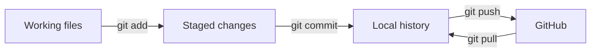

# The everyday workflow

<details markdown="block">
  <summary>
    Table of contents
  </summary>
  {: .text-delta }
1. TOC
{:toc}
</details>

This page follows one change through Git, from editing a file to seeing it on GitHub. The example is a small temperature converter. The output shown is from a real run; your commit IDs will be different.

## Where your changes are

A repository (or "repo") is a project folder together with its Git history. The history is kept in a hidden `.git` folder inside the project.

A change moves through four places:



- **working files** are the files you edit
- **staged changes** are the changes you have chosen to go in the next commit
- **local history** is the commits recorded in your copy of the repository
- **GitHub** has the shared copy, which only changes when you push

A commit records your change locally. It does not reach GitHub until you push.

## Getting a copy

In ELEC2645, GitHub Classroom creates a repository for you and you usually open it as a Codespace, which already has a copy. To get a copy on your own computer instead, clone it:

```bash
git clone <repository-url>
cd <repository-name>
```

If the repository may have changed somewhere else (in a Codespace, on another computer, or by a teammate), bring those changes in before you start:

```bash
git pull
```

## Your safety command

If you are unsure what Git thinks is happening, run:

```bash
git status
```

Use it before and after every other Git command. In a freshly cloned repository it prints:

```text
On branch main
Your branch is up to date with 'origin/main'.

nothing to commit, working tree clean
```

`origin` is Git's name for the copy on GitHub.

## Checking what changed

After adding a conversion function to `main.c`, compiling it and checking it prints `20.0 C is 68.0 F`, `git status` shows the file has changed:

```text
On branch main
Your branch is up to date with 'origin/main'.

Changes not staged for commit:
  (use "git add <file>..." to update what will be committed)
  (use "git restore <file>..." to discard changes in working directory)
	modified:   main.c

no changes added to commit (use "git add" and/or "git commit -a")
```

`git diff` shows exactly what changed. Lines starting with `+` were added and lines starting with `-` were removed:

```text
diff --git a/main.c b/main.c
index daa48d9..4a71ebb 100644
--- a/main.c
+++ b/main.c
@@ -1,7 +1,12 @@
 #include <stdio.h>
 
+double celsius_to_fahrenheit(double celsius)
+{
+    return (celsius * 9.0 / 5.0) + 32.0;
+}
+
 int main(void)
 {
-    printf("Temperature converter\n");
+    printf("20.0 C is %.1f F\n", celsius_to_fahrenheit(20.0));
     return 0;
 }
```

Reading the diff before you commit is a good habit. It catches debug `printf()` lines and changes you did not mean to make. Press `q` to leave the diff if it fills the screen.

## Choosing what to commit

`git add` stages a change, choosing it for the next commit:

```bash
git add main.c
```

`git add .` stages every change in the current folder. It is quicker, but check `git status` first so you do not add files by accident.

`git status` now lists the file under "Changes to be committed":

```text
On branch main
Your branch is up to date with 'origin/main'.

Changes to be committed:
  (use "git restore --staged <file>..." to unstage)
	modified:   main.c
```

`git diff --staged` shows the staged changes, in the same format as `git diff`.

## Recording the change

`git commit` records the staged changes in your local history, with a message saying what the change does:

```bash
git commit -m "Add Celsius conversion"
```

```text
[main 2fa8bf0] Add Celsius conversion
 1 file changed, 6 insertions(+), 1 deletion(-)
```

`2fa8bf0` is the start of the commit's ID. Every commit has one.

A good commit is one meaningful change, compiled and tested, with a short message that says what it does:

| Poor | Better |
| --- | --- |
| `changes` | `Add temperature conversion` |
| `update` | `Add menu input validation` |
| `fixed stuff` | `Correct array index in display loop` |

Future you, reading the history the night before a deadline, will be grateful.

## Sending it to GitHub

After the commit, `git status` reminds you that GitHub does not have it yet:

```text
On branch main
Your branch is ahead of 'origin/main' by 1 commit.
  (use "git push" to publish your local commits)

nothing to commit, working tree clean
```

`git push` copies your local commits to GitHub. It prints a few progress lines, then:

```text
   2f3d843..2fa8bf0  main -> main
```

and `git status` is back to "up to date with 'origin/main'".

Your commits are not on GitHub until you run `git push`!

## Looking back at the history

`git log --oneline` lists the commits, newest first:

```text
0908a53 Print a title before the conversion
2fa8bf0 Add Celsius conversion
2f3d843 Initial commit
```

Each line is a commit, not another copy of every file. Git can show you the project as it was at any of them:

```bash
git checkout 2f3d843
```

```text
Note: switching to '2f3d843'.

You are in 'detached HEAD' state. You can look around, make experimental
changes and commit them, and you can discard any commits you make in this
state without impacting any branches by switching back to a branch.

If you want to create a new branch to retain commits you create, you may
do so (now or later) by using -c with the switch command. Example:

  git switch -c <new-branch-name>

Or undo this operation with:

  git switch -

Turn off this advice by setting config variable advice.detachedHead to false

HEAD is now at 2f3d843 Initial commit
```

`main.c` is now the original version, and you can compile and run it. Nothing has been deleted: go back to the latest commit with:

```bash
git switch main
```

Do not make changes while in "detached HEAD" state. Look, test, then switch back.

## Linking a commit in your journal

Your Unit 2 project journal asks for links to specific commits. Each commit has a page on GitHub:

1. Open your repository on GitHub.
2. Click the **Commits** link (it shows the number of commits, near the top of the file list).
3. Click the commit message you want.
4. Copy the address from the browser's address bar.

The address ends with the commit's full ID:

```text
https://github.com/EEE-ELEC2645/your-repository/commit/0908a53342cb45ca8899bd01be615195ac190e0c
```

`git log -1 --format=%H` prints the full ID of your latest commit, if you want to check you have the right one. The commit must be pushed before its page exists on GitHub.

## Undoing a change before you commit

To throw away your changes to a file and go back to the last commit:

```bash
git restore main.c
```

This cannot be undone, so check `git diff` first. To unstage a file but keep your changes:

```bash
git restore --staged main.c
```

`git status` suggests both commands at the right moment, which is another reason to run it often.

## Using the Source Control panel

VS Code has buttons for the same steps, in the **Source Control** panel (the branch icon in the left-hand bar):

| Button | Command |
| --- | --- |
| **+** next to a file | `git add` |
| message box and **Commit** | `git commit -m` |
| **Sync Changes** | `git pull`, then `git push` |

Use whichever you prefer. The terminal commands are worth knowing because they work everywhere and `git status` tells you more.

## Complete example

A full session in the Codespace, from a clean repository to the change on GitHub:

```bash
git status                            # check where you are
# ... edit main.c in the editor ...
gcc -Wall -Wextra -Wpedantic -std=c11 main.c -o main.out && ./main.out
git diff                              # check what changed
git add main.c
git commit -m "Add Celsius conversion"
git push
git status                            # check it worked
```

This produces (with the `git diff` output and push progress lines left out):

```text
On branch main
Your branch is up to date with 'origin/main'.

nothing to commit, working tree clean
20.0 C is 68.0 F
[main 2fa8bf0] Add Celsius conversion
 1 file changed, 6 insertions(+), 1 deletion(-)
   2f3d843..2fa8bf0  main -> main
On branch main
Your branch is up to date with 'origin/main'.

nothing to commit, working tree clean
```

## Common mistakes

### Forgetting to push

A commit in your Codespace is not on GitHub until you push. Codespaces that are not used for a while are deleted automatically (after 30 days by default), and any commits that were never pushed go with them. Push at the end of every session.

### Committing build files

Compiled files such as `main.out` and `.o` files are rebuilt from the source, so they do not belong in Git. The lab repositories have a `.gitignore` file listing them, which tells Git to leave them out. If `git status` lists files you did not write, check before using `git add .`.

### One giant commit

"Finished project" with 40 changed files tells nobody anything, including you. Commit each working step as you go.

### Committing code that does not compile

Compile and test before you commit, so every commit in the history is a working version you can go back to.

## Summary

The main points to remember are:

- Git records the history; GitHub stores and shares a copy
- `git status` is your safety command: run it before and after everything else
- `git add` chooses changes, `git commit` records them locally, `git push` sends them to GitHub
- one meaningful, working change per commit, with a message that says what it does
- `git log --oneline` shows the history, and `git checkout <id>` lets you look at an old version
- your commits are not on GitHub until you push
