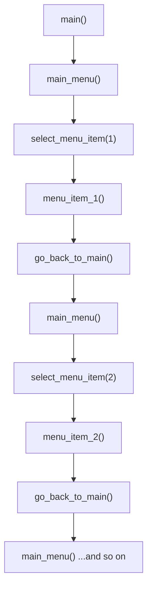

# Going back to the menu

<details markdown="block">
  <summary>
    Table of contents
  </summary>
  {: .text-delta }
1. TOC
{:toc}
</details>

[A first menu]() serves one customer and then closes. To bring the menu back after each option, Unit 2.1 Activity 1 calls the menu function again. This works, but it hides a problem that grows with the program.

## Calling the menu again

After each option, the program asks the user to go back, then calls `main_menu()`:

```c
void go_back_to_main(void)
{
    char input = ' ';

    do {
        printf("Enter 'b' to go back to the main menu: ");
        scanf(" %c", &input);
    } while (input != 'b' && input != 'B');

    main_menu();  // calls the menu again instead of returning to it
}
```

Each menu option ends by calling `go_back_to_main()`:

```c
void menu_item_1(void)
{
    int number = 0;

    printf("Enter an integer: ");
    scanf("%d", &number);
    printf("Result: %d\n", number * number);
    go_back_to_main();
}
```

The space before `%c` in `scanf(" %c", &input)` skips the newline left behind by the previous `scanf()`. Without it, `input` would be the `'\n'` from when the user pressed Enter.

## Complete example

This is a cut-down version of the Activity 1 menu:

```c
#include <stdio.h>
#include <stdlib.h>

void main_menu(void);
void print_main_menu(void);
int get_user_input(void);
void select_menu_item(int input);
void go_back_to_main(void);
void menu_item_1(void);
void menu_item_2(void);

int main(void)
{
    main_menu();
    return 0;
}

void main_menu(void)
{
    print_main_menu();
    int input = get_user_input();
    select_menu_item(input);
}

void print_main_menu(void)
{
    printf("\n--- Main menu ---\n");
    printf("1. Square a number\n");
    printf("2. Even or odd\n");
    printf("3. Exit\n");
}

int get_user_input(void)
{
    int input = 0;

    printf("Select item: ");
    scanf("%d", &input);  // assumes the user types a whole number
    return input;
}

void select_menu_item(int input)
{
    switch (input) {
        case 1:
            menu_item_1();
            break;
        case 2:
            menu_item_2();
            break;
        case 3:
            printf("Goodbye!\n");
            exit(0);
        default:
            printf("Invalid selection. Exiting...\n");
            exit(1);
    }
}

void go_back_to_main(void)
{
    char input = ' ';

    do {
        printf("Enter 'b' to go back to the main menu: ");
        scanf(" %c", &input);
    } while (input != 'b' && input != 'B');

    main_menu();  // calls the menu again instead of returning to it
}

void menu_item_1(void)
{
    int number = 0;

    printf("Enter an integer: ");
    scanf("%d", &number);
    printf("Result: %d\n", number * number);
    go_back_to_main();
}

void menu_item_2(void)
{
    int number = 0;

    printf("Enter an integer: ");
    scanf("%d", &number);

    if (number % 2 == 0) {
        printf("%d is even.\n", number);
    } else {
        printf("%d is odd.\n", number);
    }

    go_back_to_main();
}
```

`exit()` comes from `stdlib.h`. It ends the program straight away, from inside any function.

This produces (typing `1`, `5`, `b`, `2`, `7`, `b`, `3`):

```text
--- Main menu ---
1. Square a number
2. Even or odd
3. Exit
Select item: 1
Enter an integer: 5
Result: 25
Enter 'b' to go back to the main menu: b

--- Main menu ---
1. Square a number
2. Even or odd
3. Exit
Select item: 2
Enter an integer: 7
7 is odd.
Enter 'b' to go back to the main menu: b

--- Main menu ---
1. Square a number
2. Even or odd
3. Exit
Select item: 3
Goodbye!
```

It looks like the program goes round in a loop, but there is no loop.

## Following the calls

When a function calls another function, it waits for that function to finish. In this program, no function ever finishes. Each one calls the next:



It is like a waiter who, instead of going back to the counter after each order, hires a new waiter to take the next one. The café keeps working, but the staff room fills up.

## Seeing it in the debugger

You can watch this happen with the [debugger](). Put a breakpoint in `menu_item_1()`, then choose square, even or odd, then square again. On the second stop, the **Call Stack** panel lists every function that is still waiting, newest first. Simplified, it looks like this:

```text
menu_item_1()
select_menu_item(input=1)
main_menu()
go_back_to_main()
menu_item_2()
select_menu_item(input=2)
main_menu()
go_back_to_main()
menu_item_1()
select_menu_item(input=1)
main_menu()
main()
```

Every trip round the menu adds four more calls, and none of them are removed until the program ends. Each call uses some stack memory for its local variables. On a desktop it would take a very long session to run out. A microcontroller has far less memory, so in Units 3 and 4 a program that keeps calling deeper can crash.

## Where is the current mode stored?

In this program, the answer is: nowhere you can see. The program is "in the square option" only because `menu_item_1()` happens to be the function that is running. That causes problems as the program grows:

- to know where you are, you have to trace the chain of calls
- going back to the right place gets harder, for example from a settings sub-menu to the settings menu rather than the main menu
- handling errors is awkward: an invalid selection here exits, because there is no easy way to go back
- every new mode means more functions calling more functions
- the stack grows on every trip round the menu

## What we want instead

A better design needs two things:

1. one variable that says which mode the program is in
2. one loop that stays in control, so each option finishes and returns to it

That is a finite state machine, and it is how Unit 2.1 Activity 2 rebuilds this menu. See [finite state machines]().

The main points to remember are:

- calling `main_menu()` again does not go back to the menu; it starts a new one on top of the old
- every function call waits until the function it called finishes
- the Call Stack panel in the debugger shows every function that is still waiting
- if the current mode only exists as "whichever function is running", the program gets harder to follow as it grows
