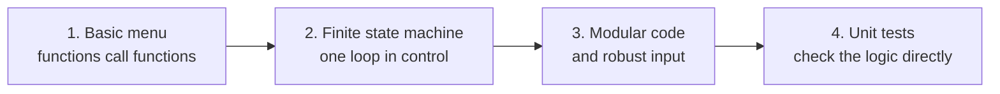

# Command line basics

For when your program needs to take orders!

A command-line interface (CLI) is a program you control by typing. It prints a menu, reads your choice and acts on it:

```c
#include <stdio.h>

int main(void)
{
    int choice = 0;

    printf("d[o_0]b Hello, I am ELEC2645 Bot.\n");
    printf("1. Tell me a joke\n");
    printf("2. Run my tests\n");
    printf("Choose: ");
    scanf("%d", &choice);

    if (choice == 1) {
        printf("Why do C programmers need glasses? They can't C#.\n");
    } else if (choice == 2) {
        printf("All tests passed. (There are no tests yet.)\n");
    } else {
        printf("Beep. That is not an option.\n");
    }

    return 0;
}
```

This produces (typing `1`):

```text
d[o_0]b Hello, I am ELEC2645 Bot.
1. Tell me a joke
2. Run my tests
Choose: 1
Why do C programmers need glasses? They can't C#.
```

## How Unit 2 builds a command-line program

The Unit 2.1 activities develop one program in four steps:



1. **Basic menu (Activity 1):** [a first menu]() and [going back to the menu]()
2. **Finite state machine (Activity 2):** [finite state machines]()
3. **Modular code and robust input (Activity 3):** [splitting a menu program](#splitting-a-menu-program) and [user input]()
4. **Unit tests (Activity 4):** [testing]()

The Unit 2 project template already has all four steps in place, so your assessed project starts from that structure.
