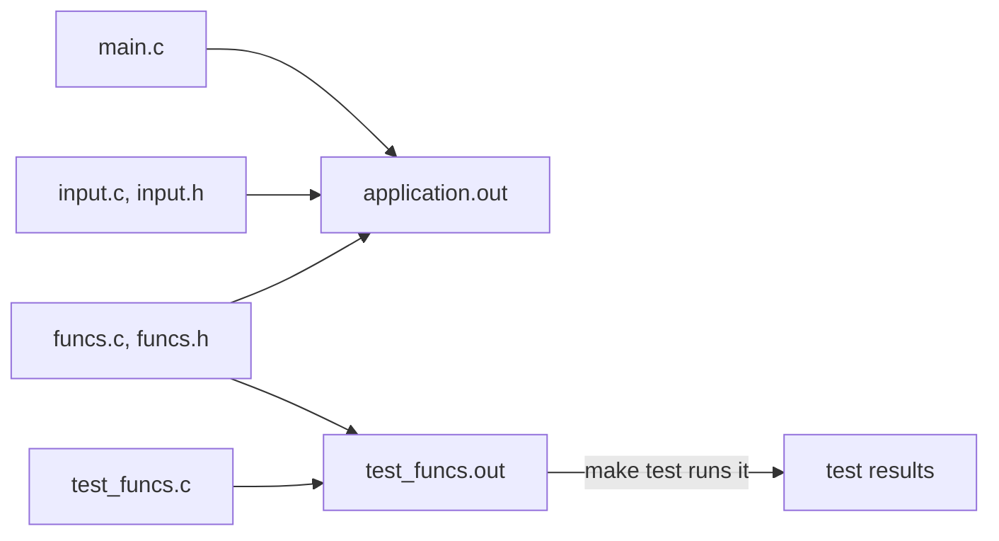

# Makefiles

<details markdown="block">
  <summary>
    Table of contents
  </summary>
  {: .text-delta }
1. TOC
{:toc}
</details>

Typing the same build commands every time gets annoying very quickly:

```bash
gcc -std=c11 -Wall -Wextra -Wpedantic -c main.c
gcc -std=c11 -Wall -Wextra -Wpedantic -c very_cool_maths.c
gcc main.o very_cool_maths.o -o very_cool_project
```

A Makefile stores these commands so that we can build the project by running:

```bash
make
```

`make` also checks which files have changed and only rebuilds the parts that need updating.

## A simple Makefile

Our project contains:

```text
very_cool_project/
├── main.c
├── very_cool_maths.c
├── very_cool_maths.h
└── Makefile
```

The Makefile is:

```make
CC = gcc
CFLAGS = -std=c11 -Wall -Wextra -Wpedantic

very_cool_project: main.o very_cool_maths.o
	$(CC) main.o very_cool_maths.o -o very_cool_project

main.o: main.c very_cool_maths.h
	$(CC) $(CFLAGS) -c main.c

very_cool_maths.o: very_cool_maths.c very_cool_maths.h
	$(CC) $(CFLAGS) -c very_cool_maths.c

.PHONY: clean

clean:
	rm -f main.o very_cool_maths.o very_cool_project
```

The file must be called `Makefile`, with a capital `M` and no file extension.

## Targets, dependencies and recipes

A Makefile rule has this form:

```make
target: dependencies
	recipe
```

For example:

```make
main.o: main.c very_cool_maths.h
	$(CC) $(CFLAGS) -c main.c
```

Here:

- `main.o` is the target being created
- `main.c` and `very_cool_maths.h` are its dependencies
- the second line is the command used to build it

The command must begin with a tab, not spaces. This is a slightly annoying Makefile requirement!

If either dependency changes, `make` rebuilds `main.o`.

## Variables

The Makefile defines the compiler and its flags near the top:

```make
CC = gcc
CFLAGS = -std=c11 -Wall -Wextra -Wpedantic
```

We use these values with:

```make
$(CC)
$(CFLAGS)
```

This avoids repeating the compiler settings in every rule.

## Building and cleaning

Running:

```bash
make
```

builds the first target in the Makefile. In our example, the first target is:

```make
very_cool_project: main.o very_cool_maths.o
```

Make first checks whether the two object files need rebuilding, then creates the executable.

If only `very_cool_maths.c` has changed, Make recompiles that file and links the program again. It does not recompile `main.c`.

To remove the object files and executable, run:

```bash
make clean
```

The `clean` rule is:

```make
clean:
	rm -f main.o very_cool_maths.o very_cool_project
```

Unlike `very_cool_project`, the `clean` target does not create a file called `clean`. It is just a name for a command we want Make to run.

We therefore mark it as a phony target:

```make
.PHONY: clean
```

This tells Make that `clean` is not a file. Without this line, a file called `clean` could cause Make to decide that the target was already up to date and skip the command.

The two commands to remember for this Makefile are:

```bash
make
make clean
```

## Makefiles in Units 1 and 2

The Makefiles used in Units 1 and 2 provide a separate test target for each activity.

At the top of the Makefile, the compiler and compiler flags are stored in variables:

```make
CC := gcc
CFLAGS := -Wall -Wextra -Wpedantic -std=c11
```

These are used in the compilation commands as:

```make
$(CC)
$(CFLAGS)
```

For example:

```make
$(CC) $(CFLAGS) activity1_hello.c -o activity1_hello.out
```

becomes:

```bash
gcc -Wall -Wextra -Wpedantic -std=c11 activity1_hello.c -o activity1_hello.out
```

### Choosing a test

Running `make` without naming a target runs the first ordinary target in the Makefile.

In the activity Makefiles, the first target is:

```make
test:
	@echo "Choose an activity test:"
	@echo "  make test1  Activity 1: Hello World"
	@echo "  make test2  Activity 2: Data Types"
	@echo "  make test3  Activity 3: Loops"
```

Therefore, running:

```bash
make
```

displays the list of available tests.

To build and test a particular activity, give the target name:

```bash
make test1
make test2
make test3
```

For example:

```make
test2: activity2_data_types.out
	@bash activity2_test.sh
```

When we run:

```bash
make test2
```

Make first checks whether the required program is available and up to date:

```text
activity2_data_types.out
```

If necessary, Make builds the program. It then runs:

```bash
bash activity2_test.sh
```

The `@` before a command stops Make from printing the command itself. The output produced by the command still appears.

### Phony targets

The Makefile contains:

```make
.PHONY: test test1 test2 test3 test4 test5 test6 clean
```

These targets do not create files called `test1`, `test2` or `clean`. They are names for commands that we want Make to run.

Declaring them as phony tells Make not to look for files with those names.

Without `.PHONY`, a file called `test2` could cause Make to decide that the target was already up to date and skip the test.

### Building the program

Each output file has its own build rule:

```make
activity2_data_types.out: activity2_data_types.c
	$(CC) $(CFLAGS) $< -o $@
```

Here:

- `activity2_data_types.out` is the target
- `activity2_data_types.c` is the dependency
- the second line is the compilation command

The recipe uses two automatic variables:

- `$<` means the first dependency
- `$@` means the target

For this rule:

```text
$< = activity2_data_types.c
$@ = activity2_data_types.out
```

The command therefore becomes:

```bash
gcc -Wall -Wextra -Wpedantic -std=c11 activity2_data_types.c -o activity2_data_types.out
```

Using `$<` and `$@` avoids repeating the filenames in every rule.

### Cleaning the project

The `clean` target removes the compiled programs:

```make
clean:
	rm -f *.out
```

Run it using:

```bash
make clean
```

The `*` in `*.out` is a wildcard, so this removes every file whose name ends in `.out`.

The main commands to remember are:

```bash
make
make test1
make test2
make clean
```

Running `make` shows the available tests. Running `make test1`, `make test2` and so on builds and tests the chosen activity.

## The Unit 2 project Makefile

The Unit 2 project template builds two programs from the same library: the interactive application and a separate test program (see [testing](#compile-the-library-twice)). Its Makefile is set up for that.

### Compiler flags

```make
CC := gcc
CFLAGS := -Wall -Wextra -Wpedantic -std=c11 -g -O0
```

These are the Unit 1 flags plus two more: `-g` adds the information the debugger needs, and `-O0` turns off optimisation so that stepping through the code follows the lines you wrote. See [debug and release builds]().

### Source lists

Instead of naming files in every rule, the template lists them once in variables:

```make
APP_SOURCES := main.c funcs.c input.c
APP_HEADERS := funcs.h input.h

TEST_SOURCES := test_funcs.c funcs.c
TEST_HEADERS := funcs.h
```

The test program uses `funcs.c`, but not `main.c` or `input.c`, so it never shows the menu or waits for the keyboard.

### The two programs

```make
application.out: $(APP_SOURCES) $(APP_HEADERS)
	$(CC) $(CFLAGS) $(APP_SOURCES) -o $@

test_funcs.out: $(TEST_SOURCES) $(TEST_HEADERS)
	$(CC) $(CFLAGS) $(TEST_SOURCES) -o $@
```

The headers are dependencies but are not passed to `gcc`. Listing them means that changing `funcs.h` makes Make rebuild both programs. They are left out of the compile command because the `.c` files already include them.



An arrow means "is needed to build". If any file on the left changes, Make rebuilds every program it points to, and only those.

### The `all`, `test` and `clean` targets

```make
.PHONY: all test clean

all: application.out

test: test_funcs.out
	./test_funcs.out

clean:
	rm -f *.out *.o
```

- `all` is the first target, so running `make` on its own builds the application
- `make test` builds `test_funcs.out` if it is missing or out of date, then runs it. If any test fails, the test program returns `1` from `main()` and Make reports an error (see [make a test fail on purpose](#make-a-test-fail-on-purpose))
- `make clean` removes the programs and any object files

### Adding a source file

The Makefile does not find source files by itself. If your project adds `quiz.c` and `quiz.h`, add them to the lists:

```make
APP_SOURCES := main.c funcs.c input.c quiz.c
APP_HEADERS := funcs.h input.h quiz.h
```

If the tests use `quiz.c` too, add it to `TEST_SOURCES` and `quiz.h` to `TEST_HEADERS`. Forgetting to add the `.c` file gives a linker error when you build:

```text
main.c:28:(.text+0x10): undefined reference to `quiz_run'
collect2: error: ld returned 1 exit status
make: *** [Makefile:35: application.out] Error 1
```

(The start of the first line shows the full path to `main.c`.) After changing the lists, rebuild everything with `make clean` and then `make`.

### Using the maths library

Programs that use functions from `math.h`, such as `sqrt()` or `pow()`, must be linked with `-lm` (see [linking the maths library](#linking-the-maths-library)). The template does not include it, so add it to the end of both recipe lines:

```make
application.out: $(APP_SOURCES) $(APP_HEADERS)
	$(CC) $(CFLAGS) $(APP_SOURCES) -o $@ -lm

test_funcs.out: $(TEST_SOURCES) $(TEST_HEADERS)
	$(CC) $(CFLAGS) $(TEST_SOURCES) -o $@ -lm
```

Add it to both, because the tests compile `funcs.c` as well. If `funcs.c` calls `sqrt()` and the test recipe has no `-lm`, `make test` fails with:

```text
funcs.c:40:(.text+0x74): undefined reference to `sqrt'
collect2: error: ld returned 1 exit status
make: *** [Makefile:41: test_funcs.out] Error 1
```

### Commands to remember

```bash
make
./application.out
make test
make clean
```

`make` builds the application, `./application.out` runs it, `make test` builds and runs the tests, and `make clean` removes everything that was built.

Later, the STM32 projects will use CMake. A Makefile contains the build rules directly, while CMake describes the project and generates the files needed by the build system.