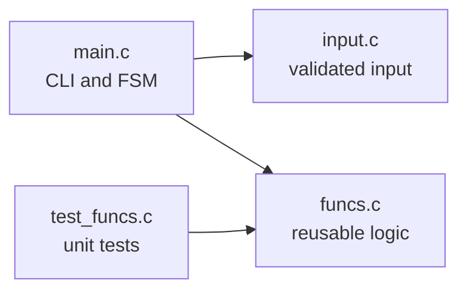

# Multi-file C projects

<details markdown="block">
  <summary>
    Table of contents
  </summary>
  {: .text-delta }
1. TOC
{:toc}
</details>


Small programs can be written entirely inside `main.c`, but as the program grows, this quickly becomes difficult to manage!

We can split the program into separate **modules**, with each module responsible for one part of the project.

A small project might contain:

```text
very_cool_project/
├── main.c
├── very_cool_maths.c
└── very_cool_maths.h
```

The maths module uses two files:

```text
very_cool_maths.h
very_cool_maths.c
```

The `.h` header file describes the functions provided by the module. The `.c` source file contains the function definitions.

## Header files `.h`

A header file normally contains the declarations that other source files need to use.

For example:

```c
// very_cool_maths.h

#ifndef VERY_COOL_MATHS_H
#define VERY_COOL_MATHS_H

int add_exciting_numbers(int first, int second);
int multiply_thrilling_numbers(int first, int second);

#endif
```

The function prototypes tell the compiler:

- the function names
- the parameter types
- the return types

The header does not contain the function bodies.

The `#ifndef`, `#define` and `#endif` lines form a **header guard**. Header guards are explained on a later page.

## Source files `.c`

The source file contains the function definitions:

```c
// very_cool_maths.c

#include "very_cool_maths.h"

int add_exciting_numbers(int first, int second)
{
    return first + second;
}

int multiply_thrilling_numbers(int first, int second)
{
    return first * second;
}
```

The source file includes its own header:

```c
#include "very_cool_maths.h"
```

This allows the compiler to check that the function definitions match the prototypes in the header, if they don't the compiler will report an error.

## Using the module from `main.c`

The program includes the header and calls the functions:

```c
// main.c

#include <stdio.h>
#include "very_cool_maths.h"

int main(void)
{
    int exciting_result = add_exciting_numbers(10, 20);
    int thrilling_result = multiply_thrilling_numbers(4, 5);

    printf("The exciting result is %d!\n", exciting_result);
    printf("The thrilling result is %d!\n", thrilling_result);

    return 0;
}
```

`main.c` does not need to see the function bodies. The header provides enough information for the compiler to check the function calls.

The definitions are compiled separately from `very_cool_maths.c` and combined with `main.c` when the program is built.

## Using quotation marks and angle brackets

Project headers are normally included using quotation marks:

```c
#include "very_cool_maths.h"
```

Standard library headers use angle brackets:

```c
#include <stdio.h>
```

Quotation marks tell the compiler to look for a header belonging to the current project.

Angle brackets tell the compiler to look in the system header locations.

## Compiling the project

Both `.c` files must be included when compiling the program:

```bash
gcc main.c very_cool_maths.c -o very_cool_project
```

We do *not* list the header file on the command line as the source files include the headers they need. The compiler compiles the `.c` files and then combines them into the final executable.

We will look at the compilation and linking steps in more detail on the next page.

## Do not include `.c` files

Include the header:

```c
#include "very_cool_maths.h"
```

Do not include the source file:

```c
#include "very_cool_maths.c"
```

Each `.c` file should be compiled as a separate source file.

Including a `.c` file copies its function definitions into another source file. If the original `.c` file is also compiled, the same functions may be defined more than once and the linker will complain.

## What belongs in each file?

The header file contains the public parts of the module:

```c
// very_cool_maths.h

int add_exciting_numbers(int first, int second);
int multiply_thrilling_numbers(int first, int second);
```

The source file contains the implementation:

```c
// very_cool_maths.c

#include "very_cool_maths.h"

int add_exciting_numbers(int first, int second)
{
    return first + second;
}
```

The main program includes the header and uses the module:

```c
// main.c

#include "very_cool_maths.h"
```

A useful way to remember this is:

```text
Header file:  what the module provides
Source file:  how the module works
```

Functions and variables that are private to one source file can be declared as `static`, as covered in [static functions]().

## Splitting a menu program

Unit 2.1 Activity 3 and the Unit 2 project template split a menu program into three modules. To see why, here is the start of a menu program with everything in `main.c`:

```c
int main(void)
{
    int selection;
    int value;

    scanf("%d", &selection);
    scanf("%d", &value);

    if (selection == 1) {
        printf("%d\n", value * value);
    }

    // more menu options...
}
```

This is hard to test and hard to grow:

- the calculation is tangled up with reading the keyboard
- the answer is tangled up with printing
- to check one calculation, you have to drive the whole menu by typing
- the calculation cannot be reused anywhere else
- one big file gets hard to find your way around

### Three files, three jobs

The template gives each part of the program its own module:

| File | Job | Contains |
|---|---|---|
| `main.c` | command-line interface and FSM | prompts, output and state transitions |
| `input.c` and `input.h` | validated input | `read_integer()`, which reads and converts whole lines |
| `funcs.c` and `funcs.h` | reusable logic | `square_int()` and `cube_int()`, which calculate results without the terminal |

Each file has one clear reason to change. A new menu option changes `main.c`, stricter input checking changes `input.c`, and a better calculation changes `funcs.c`.



`main.c` calls the other modules; they never call `main.c`. The functions in `funcs.c` do not call `scanf()`, and preferably not `printf()` either. They take values as parameters and return results:

```c
// Hard to test: reads the keyboard and prints the answer
void square_from_keyboard(void)
{
    int value;

    scanf("%d", &value);
    printf("%d\n", value * value);
}

// Easy to test: value in, result out
int square_int(int value)
{
    return value * value;
}
```

`main.c` does the reading and printing, and asks `funcs.c` for the answer:

```c
if (!read_integer("Enter an integer: ", &value)) {
    printf("Invalid integer. Returning to the menu.\n");
    return;
}

printf("Result: %d\n", square_int(value));
```

Because `square_int()` never touches the terminal, a separate test program can call it with known values and check the results. That is the arrow from `test_funcs.c` in the diagram, and it is how [testing]() works in Unit 2.

### The header is the menu

The header file is the menu: it lists what is on offer. The source file is the kitchen: it is where the work is done.

```c
// funcs.h

#ifndef FUNCS_H
#define FUNCS_H

int square_int(int value);
int cube_int(int value);
int funcs_get_operation_count(void);
void funcs_reset_operation_count(void);

#endif
```

`main.c` and `test_funcs.c` order from the menu by including `funcs.h`. They never go into the kitchen: anything in `funcs.c` that is not on the menu, such as the private `operation_count` variable, stays there. See [private variables in a source file](#private-variables-in-a-source-file).

The whole application is built from all three source files:

```bash
gcc -Wall -Wextra -Wpedantic -std=c11 main.c funcs.c input.c -o application.out
```

In practice the template's [Makefile]() runs this command for you.

The main points to remember are:

- a header file says what a module provides; its source file says how it works
- include headers, never `.c` files, and compile every `.c` file
- in Unit 2, `main.c` owns the interface and the FSM, `input.c` reads input and `funcs.c` holds the reusable logic
- reusable functions take values as parameters and return results, without `scanf()` or `printf()`, so they can be tested directly
